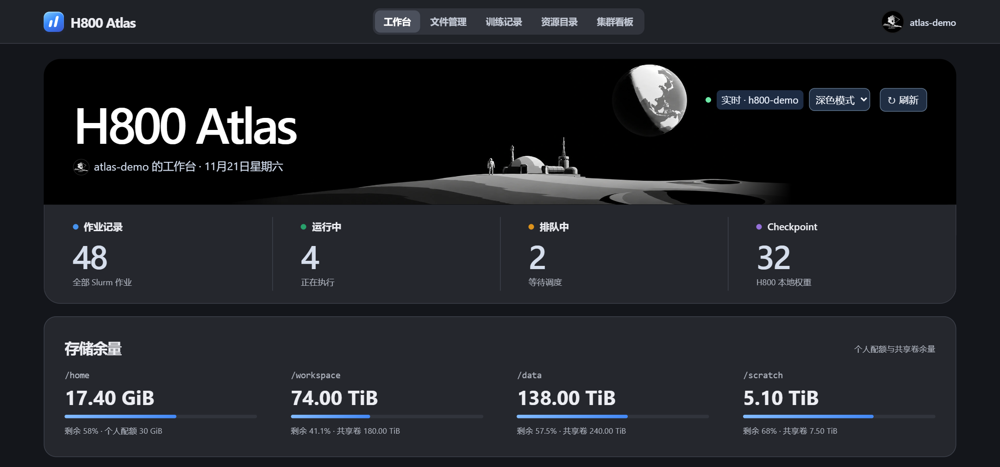
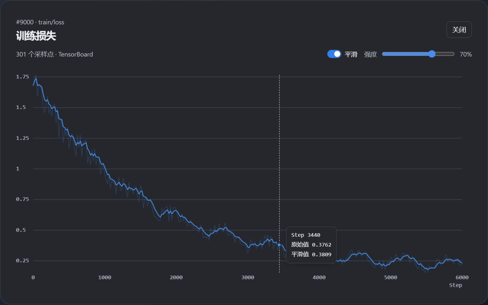
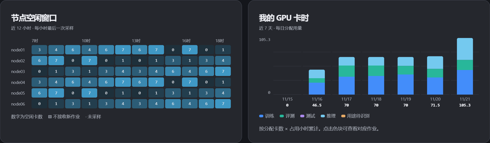
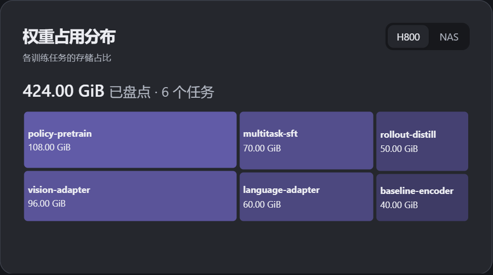

<h1 align="center">H800 Atlas</h1>

Experiment monitoring, GPU accounting, and checkpoint provenance for Slurm clusters

  
  

## Overview

A Slurm job records a resource allocation. A training run produces a sequence of measurements and checkpoints. These records can diverge when training restarts within an allocation or when a checkpoint is copied to another storage system. H800 Atlas links the three records so that a researcher can trace a GPU-hour total to its contributing jobs, inspect the underlying training metrics, and locate each replica of a checkpoint.

*Figure 1. Personal workspace. The upper panel summarizes the account’s jobs and checkpoints. The lower panel reports available storage on each volume. All figures show the Atlas interface with demonstration data.*

## Training analysis

The training view associates Slurm job IDs with logs and scalar histories from TensorBoard, Weights & Biases, SwanLab, and supported text or JSON logs. Each series retains its original step or epoch coordinates. Selecting a metric opens a larger plot with point inspection and optional smoothing. When an allocation contains multiple recorded attempts, the detail view distinguishes their outcomes from the final Slurm state.

*Figure 2. Inspection of a training-loss series. At step 3,440, the recorded loss is 0.3762 and the smoothed estimate is 0.3809. Both remain available at the selected point.*

## Cluster monitoring and GPU accounting

Atlas samples Slurm node state every five minutes. The availability heatmap displays the last sample in each hourly bin over a twelve-hour window. The personal usage chart aggregates GPU allocations by calendar day. For each job, Atlas multiplies the number of allocated GPUs by the hours that its allocation overlaps the day. An eight-GPU allocation spanning two hours contributes 16 GPU-hours.

Purpose labels use the job name, associated training records, submitted script name, and program entry points identifiable in that script. Jobs with insufficient evidence remain unclassified and still contribute to total GPU-hours. Selecting a segment reveals its contributing job IDs.

*Figure 3. The left panel reports free GPUs at sampled times. The right panel reports allocated GPU-hours for training, evaluation, testing, inference, and unclassified work.*

## Checkpoint catalog and storage

The catalog groups checkpoints by training run and step. A step with replicas on H800, NAS, Grus, and Tianji appears once, with the physical locations available in its detail view. NAS supports full checkpoint backups. Grus and Tianji receive inference artifacts. Transfer records expose destination paths and verification results, and local cleanup requires a verified full NAS copy.

*Figure 4. The six example runs occupy 424 GiB on H800. Tile area is proportional to the recorded size of each run’s checkpoints. The storage selector also exposes the NAS inventory.*

## Architecture and access

The browser connects to a gateway that authenticates the user over SSH on the selected H800 node. A worker running under that Linux account reads Slurm records, logs, and files within the configured roots. Cluster-wide views reflect the scheduler data visible to the account. The storage ranking reads shared-volume measurements for `/home`, `/workspace`, and `/data` from the storage API on node11. The `/scratch` ranking covers that node’s local disk.

The repository is public. The deployed workspace requires access to the team network or VPN and an authorized H800 account. An SSH tunnel is available when the node is reachable directly. [Workspace sign-in](https://atlas.int.mintibot.com/login) · [Tunnel client](client/)

## Deployment and implementation

The reference installation uses Linux, Python 3.10, Slurm command-line tools, OpenSSH, and systemd user services. The release script assembles the browser assets, validates the Python sources, and activates a versioned release. For another installation, review the deployment paths, host configuration, and storage integrations before running the script.

[Gateway](gateway.py) · [Per-user worker](server.py) · [Accounting and training series](charts.py) · [Release script](publish.sh) · [Deployment and operations reference (Chinese)](docs/operations.zh-CN.md)
