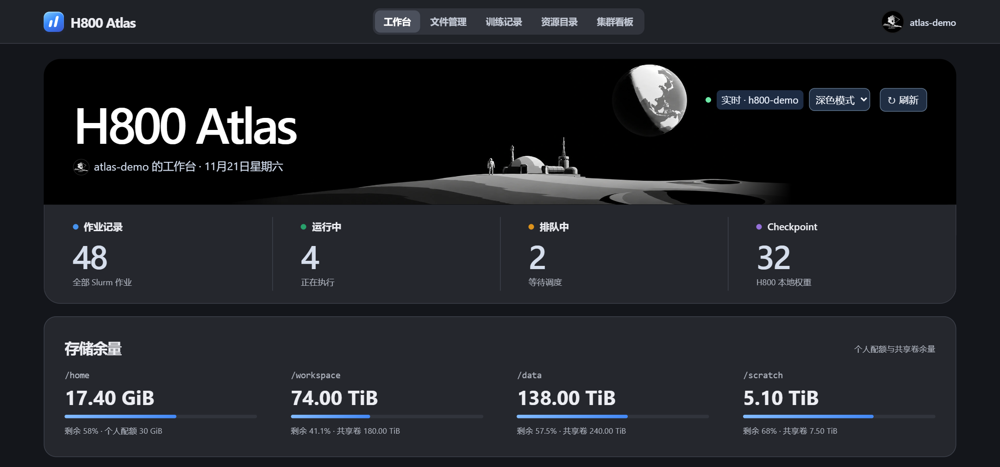
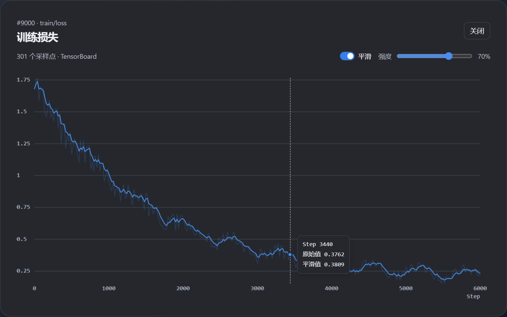
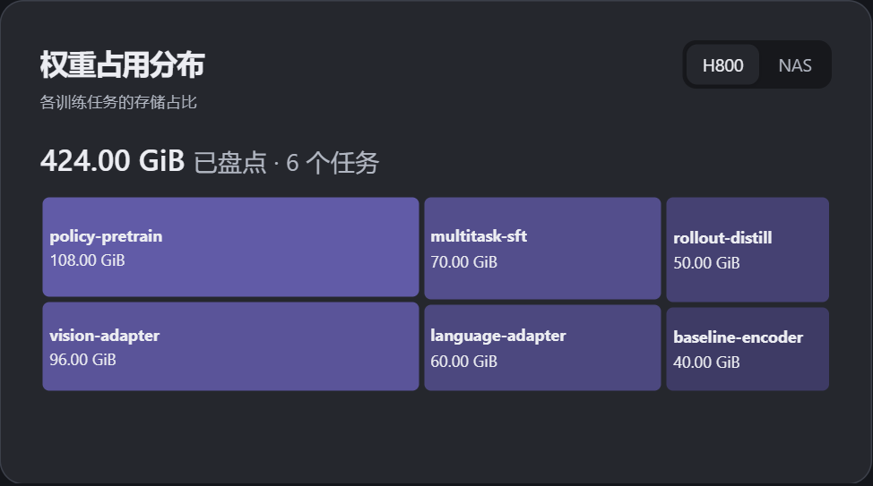

<h1 align="center">H800 Atlas</h1>

面向 Slurm 集群的训练监测、GPU 资源核算与 checkpoint 来源追踪

  
  

## 系统概述

Slurm 作业记录资源分配的起止时间，训练过程则产生指标序列与 checkpoint。一次资源分配中可以发生多次训练尝试，同一 checkpoint 也可以保存在不同的存储系统。H800 Atlas 将作业、训练记录与权重副本关联，使研究人员能够从每日 GPU 卡时追溯到具体作业，检查训练指标，并定位指定步数的权重文件。

*图 1　个人工作台。上方汇总当前账号的作业与 checkpoint，下方展示各存储卷的可用容量。全文配图均取自 Atlas 实际界面，使用演示数据。*

## 训练过程分析

训练视图按 Slurm 作业号关联日志与标量序列，支持 TensorBoard、Weights & Biases、SwanLab 以及符合格式的文本或 JSON 日志。各序列保留原始训练步数或 epoch 坐标。选中指标后可放大曲线、检查采样点并调节平滑强度。若同一次资源分配包含多次有记录的训练尝试，详情页分别展示各次尝试的结果与 Slurm 作业终态。

*图 2　训练损失的逐点检查。在第 3,440 步，原始损失为 0.3762，平滑估计为 0.3809，二者可在同一采样位置对照。*

## 集群监测与 GPU 资源核算

Atlas 每五分钟采集一次 Slurm 节点状态。空闲窗口热图覆盖最近十二小时，每个单元格取相应小时内的最后一次采样。个人 GPU 用量按自然日统计。每项作业对当天卡时的贡献，等于分配的 GPU 数乘以分配时段与当天重叠的小时数。例如，8 张 GPU 连续分配 2 小时，计入 16 卡时。

作业用途的判断依据包括作业名、关联的训练记录、提交脚本名，以及脚本中可识别的程序入口。证据不足的作业归入「用途待识别」，其卡时仍计入总量。点击图中色块可查看该项统计包含的作业号。

*图 3　左图给出各节点在采样时刻的空闲 GPU 数。右图给出训练、评测、测试、推理及用途待识别作业的每日分配卡时。*

## Checkpoint 目录与存储管理

资源目录以训练任务和步数组织 checkpoint。同一步数在 H800、NAS、Grus 和 Tianji 上存在多个副本时，目录中合并为一个条目，详情页列出各物理位置。NAS 用于保存完整 checkpoint，Grus 和 Tianji 用于存放推理文件。操作记录提供目标路径和校验结果；清理 H800 本地权重前，系统要求先核验完整的 NAS 副本。

*图 4　示例中的六个训练任务在 H800 上共占用 424 GiB。每个矩形的面积与该任务已统计的 checkpoint 容量成正比。切换存储位置可查看 NAS 上的分布。*

## 系统架构与访问

浏览器通过网关连接所选 H800 节点的 SSH 服务完成身份认证。工作进程以该 Linux 账号的身份读取 Slurm 记录、日志和配置范围内的文件。集群视图展示当前账号可见的调度数据。存储用量排行通过 node11 的存储接口获取 `/home`、`/workspace` 和 `/data` 的目录用量，`/scratch` 的统计范围为该节点的本地盘。

源码仓库公开。访问已部署的工作台需要接入团队内网或 VPN，并使用获授权的 H800 账号。可直接通过 SSH 访问节点的用户也可使用隧道客户端。[工作台登录入口](https://atlas.int.mintibot.com/login) · [SSH 隧道客户端](client/)

## 部署与实现

参考部署环境采用 Linux、Python 3.10、Slurm 命令行工具、OpenSSH 和 systemd 用户服务。发布脚本组装前端资源、校验 Python 源码并启用对应版本。在其他环境部署前，需核对安装路径、主机配置及存储系统的接入方式。

[访问网关](gateway.py) · [用户工作进程](server.py) · [资源统计与训练序列](charts.py) · [发布脚本](publish.sh) · [部署与运行参考](docs/operations.zh-CN.md)
