<h1 align="center">H800 Atlas</h1>

<kbd>EN</kbd> <strong>English</strong>

Experiment monitoring, GPU accounting, and checkpoint provenance for Slurm clusters

## Overview

A Slurm job records a resource allocation. A training run produces a sequence of measurements and checkpoints. These records can diverge when training restarts within an allocation or when a checkpoint is copied to another storage system. H800 Atlas links the three records so that a researcher can trace a GPU-hour total to its contributing jobs, inspect the underlying training metrics, and locate each replica of a checkpoint.

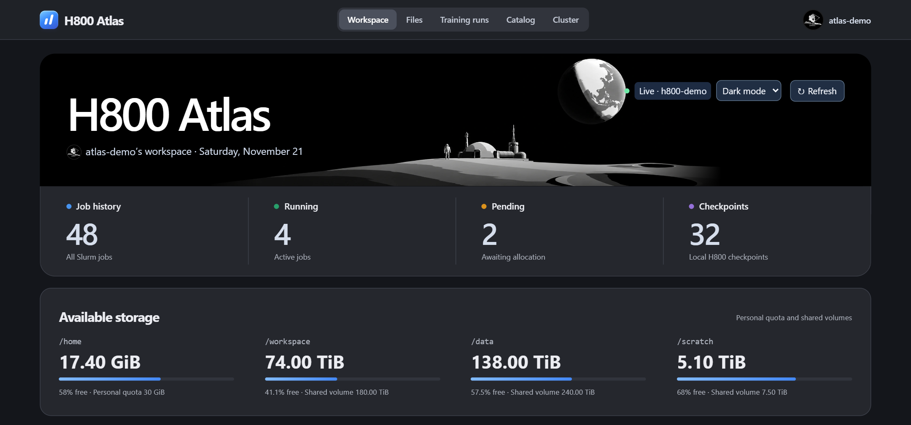

*Figure 1. Personal workspace. The upper panel summarizes the account’s jobs and checkpoints. The lower panel reports available storage on each volume. Both editions use matching data and views. Figures 1–3 and 5 use demonstration data. Figure 4 records a cluster snapshot. English interface labels are localized for this documentation.*

## Training analysis

The training view associates Slurm job IDs with logs and scalar histories from TensorBoard, Weights & Biases, SwanLab, and supported text or JSON logs. Each series retains its original step or epoch coordinates. Selecting a metric opens a larger plot with point inspection and optional smoothing. When an allocation contains multiple recorded attempts, the detail view distinguishes their outcomes from the final Slurm state.

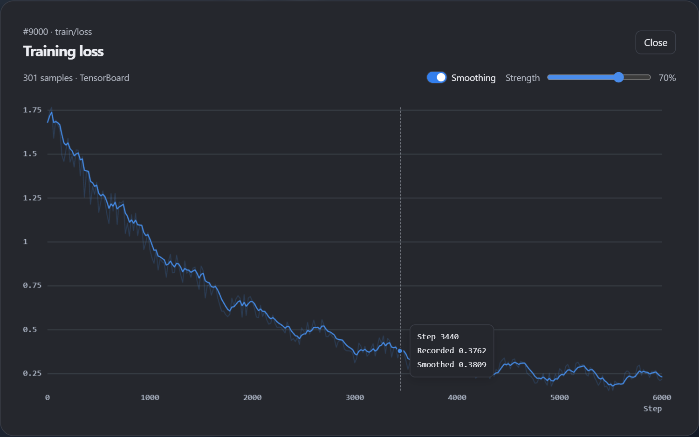

*Figure 2. Inspection of a training-loss series. At step 3,440, the recorded loss is 0.3762 and the smoothed estimate is 0.3809. Both remain available at the selected point.*

## Cluster monitoring and GPU accounting

Atlas samples Slurm node state every five minutes. The availability heatmap displays the last sample in each hourly bin over a twelve-hour window. The personal usage chart aggregates GPU allocations by calendar day. For each job, Atlas multiplies the number of allocated GPUs by the hours that its allocation overlaps the day. An eight-GPU allocation spanning two hours contributes 16 GPU-hours.

Purpose labels use the job name, associated training records, submitted script name, and program entry points identifiable in that script. Jobs with insufficient evidence remain unclassified and still contribute to total GPU-hours. Selecting a segment reveals its contributing job IDs.

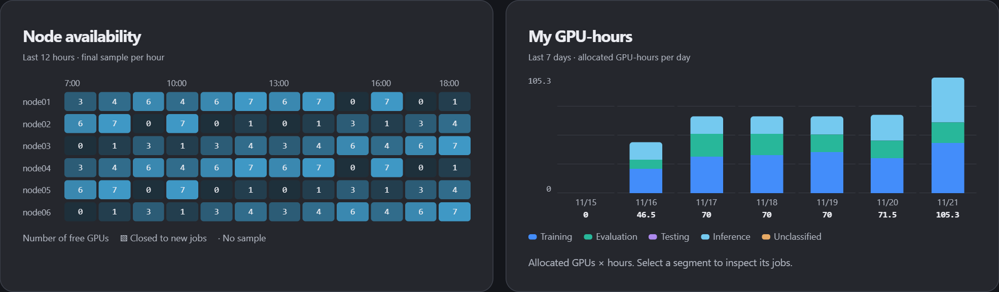

*Figure 3. The left panel reports free GPUs at sampled times. The right panel reports allocated GPU-hours for training, evaluation, testing, inference, and unclassified work.*

### Scheduling policy, node allocation, and pending jobs

The following panels share a single snapshot taken on 21 November 2026 at 13:03 CST (UTC+8). Account and job names are replaced by aliases.

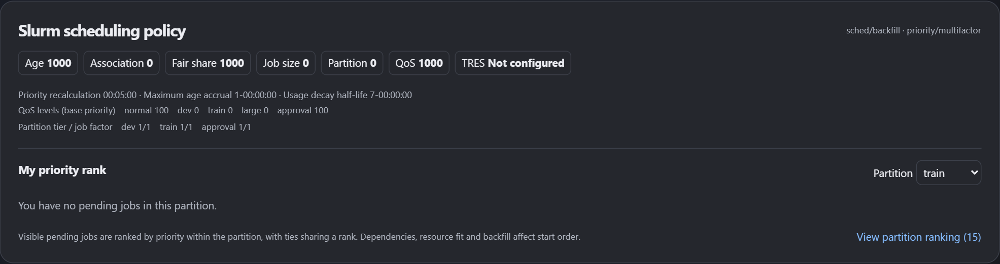

*Figure 4a. Scheduling policy. Age, fair share, and QoS each have a configured weight of 1,000. The partition selector scopes the priority ranking to pending jobs in the selected partition.*

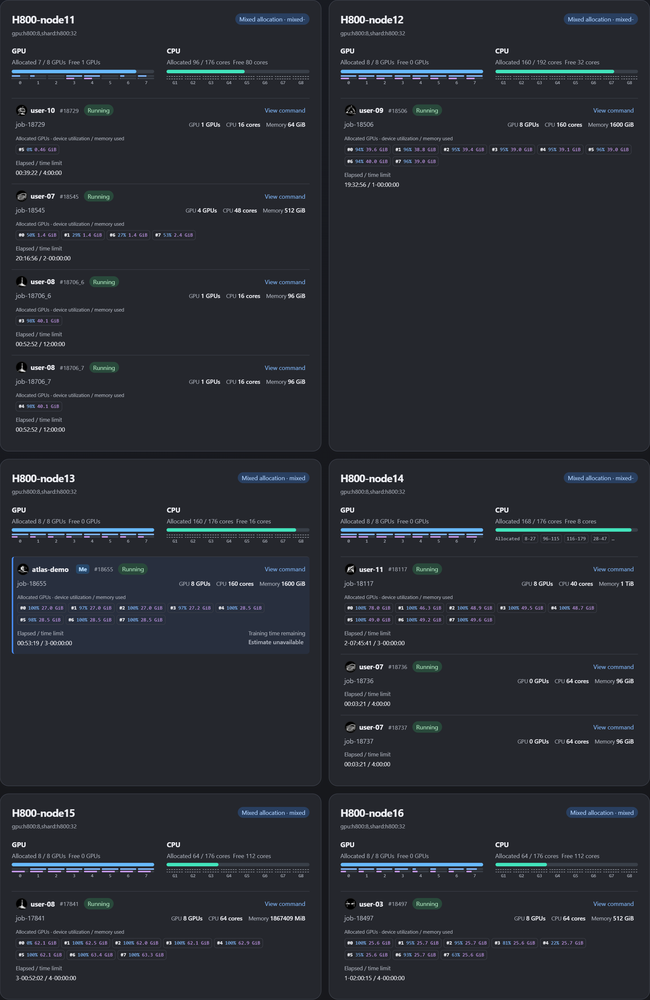

*Figure 4b. Node allocation. At capture time, node11 had one unallocated GPU and the other five nodes had none. The per-device readings show utilization and memory use within an allocation.*

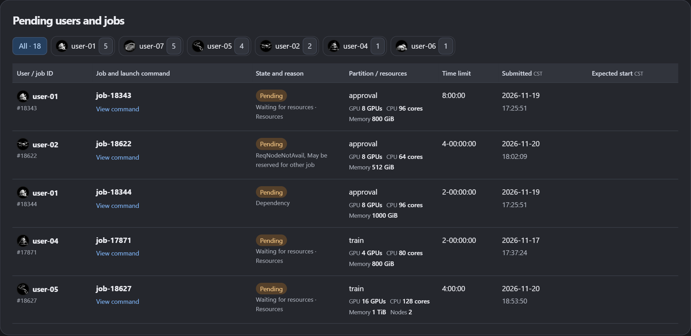

*Figure 4c. Queue detail. Five of the 18 pending jobs are shown. The reason column distinguishes resource waits, dependencies, and user holds.*

## Checkpoint catalog and storage

The catalog groups checkpoints by training run and step. A step with replicas on H800, NAS, Grus, and Tianji appears once, with the physical locations available in its detail view. NAS supports full checkpoint backups. Grus and Tianji receive inference artifacts. Transfer records expose destination paths and verification results, and local cleanup requires a verified full NAS copy.

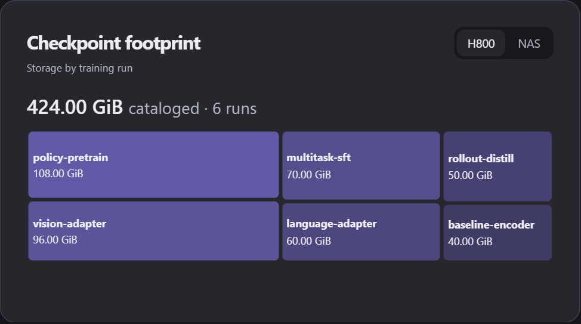

*Figure 5. The six example runs occupy 424 GiB on H800. Tile area is proportional to the recorded size of each run’s checkpoints. The storage selector also exposes the NAS inventory.*

## Architecture and access

The browser connects to a gateway that authenticates the user over SSH on the selected H800 node. A worker running under that Linux account reads Slurm records, logs, and files within the configured roots. Cluster-wide views reflect the scheduler data visible to the account. The storage ranking reads shared-volume measurements for `/home`, `/workspace`, and `/data` from the storage API on node11. The `/scratch` ranking covers that node’s local disk.

The repository is public. The deployed workspace requires access to the team network or VPN and an authorized H800 account. An SSH tunnel is available when the node is reachable directly. [Workspace sign-in](https://atlas.int.mintibot.com/login) · [Tunnel client](client/)

## Deployment and implementation

The reference installation uses Linux, Python 3.10, Slurm command-line tools, OpenSSH, and systemd user services. The release script assembles the browser assets, validates the Python sources, and activates a versioned release. For another installation, review the deployment paths, host configuration, and storage integrations before running the script.

[Gateway](gateway.py) · [Per-user worker](server.py) · [Accounting and training series](charts.py) · [Release script](publish.sh) · [Deployment and operations reference (Chinese)](docs/operations.zh-CN.md)

<kbd>ZH</kbd> <strong>简体中文</strong>

面向 Slurm 集群的训练监测、GPU 资源核算与 checkpoint 来源追踪

## 系统概述

Slurm 作业记录资源分配的起止时间，训练过程则产生指标序列与 checkpoint。一次资源分配中可以发生多次训练尝试，同一 checkpoint 也可以保存在不同的存储系统。H800 Atlas 将作业、训练记录与权重副本关联，使研究人员能够从每日 GPU 卡时追溯到具体作业，检查训练指标，并定位指定步数的权重文件。

*图 1　个人工作台。上方汇总当前账号的作业与 checkpoint，下方展示各存储卷的可用容量。两版配图取自相同界面并使用相同数据。图 1–3 和图 5 使用演示数据，图 4 为集群实测快照。*

## 训练过程分析

训练视图按 Slurm 作业号关联日志与标量序列，支持 TensorBoard、Weights & Biases、SwanLab 以及符合格式的文本或 JSON 日志。各序列保留原始训练步数或 epoch 坐标。选中指标后可放大曲线、检查采样点并调节平滑强度。若同一次资源分配包含多次有记录的训练尝试，详情页分别展示各次尝试的结果与 Slurm 作业终态。

*图 2　训练损失的逐点检查。在第 3,440 步，原始损失为 0.3762，平滑估计为 0.3809，二者可在同一采样位置对照。*

## 集群监测与 GPU 资源核算

Atlas 每五分钟采集一次 Slurm 节点状态。空闲窗口热图覆盖最近十二小时，每个单元格取相应小时内的最后一次采样。个人 GPU 用量按自然日统计。每项作业对当天卡时的贡献，等于分配的 GPU 数乘以分配时段与当天重叠的小时数。例如，8 张 GPU 连续分配 2 小时，计入 16 卡时。

作业用途的判断依据包括作业名、关联的训练记录、提交脚本名，以及脚本中可识别的程序入口。证据不足的作业归入「用途待识别」，其卡时仍计入总量。点击图中色块可查看该项统计包含的作业号。

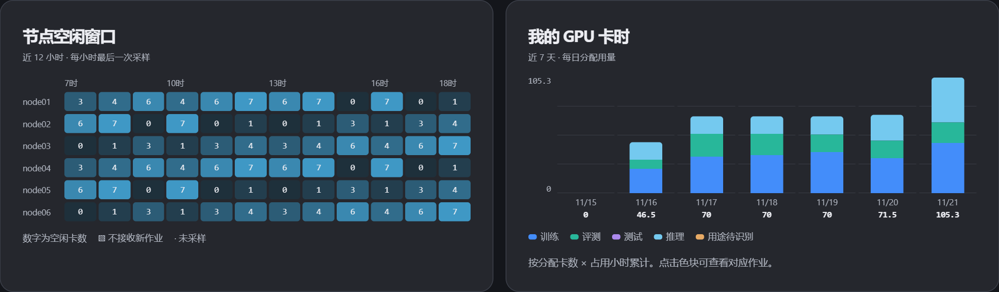

*图 3　左图给出各节点在采样时刻的空闲 GPU 数。右图给出训练、评测、测试、推理及用途待识别作业的每日分配卡时。*

### 调度策略、节点分配与待调度作业

以下三个面板来自同一次集群采样，采样时间为北京时间 2026 年 11 月 21 日 13:03。账号名与作业名在公开配图中以代号展示。

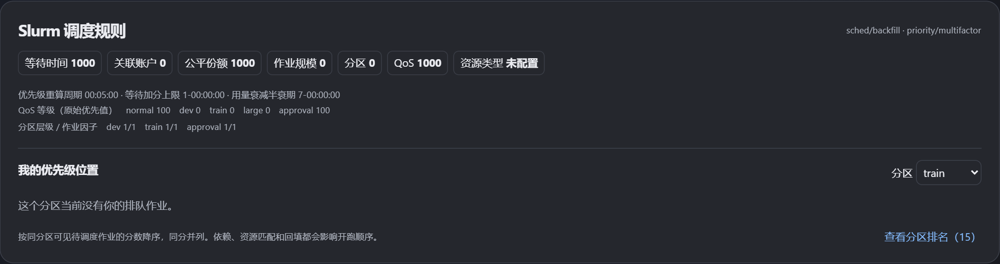

*图 4a　调度策略。等待时间、公平份额与 QoS 的配置权重均为 1,000。分区选择器用于查看该分区内待调度作业的优先级排名。*

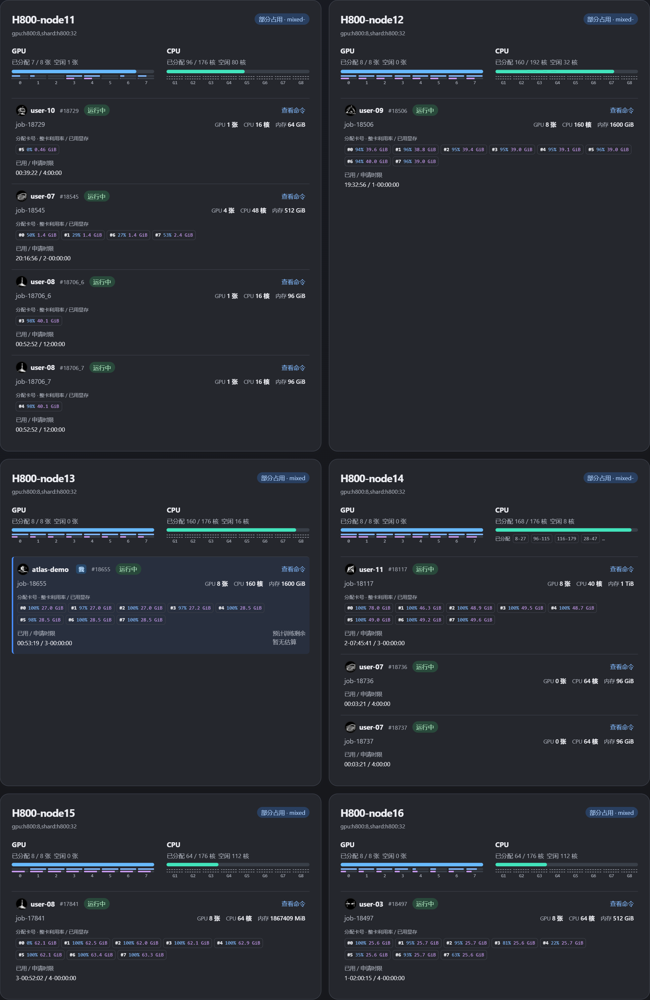

*图 4b　节点资源分配。采样时 node11 尚有 1 张未分配的 GPU，其余五个节点的 GPU 均已分配。逐卡读数展示分配期间的利用率和显存用量。*

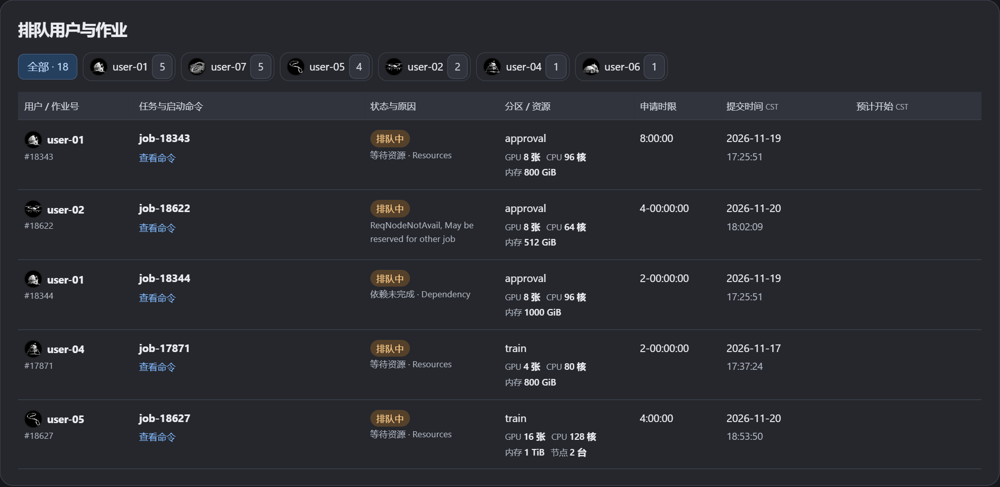

*图 4c　排队明细。图中展示当时 18 个待调度作业中的前 5 个。排队原因列可区分等待资源、依赖未完成和用户暂停等情况。*

## Checkpoint 目录与存储管理

资源目录以训练任务和步数组织 checkpoint。同一步数在 H800、NAS、Grus 和 Tianji 上存在多个副本时，目录中合并为一个条目，详情页列出各物理位置。NAS 用于保存完整 checkpoint，Grus 和 Tianji 用于存放推理文件。操作记录提供目标路径和校验结果；清理 H800 本地权重前，系统要求先核验完整的 NAS 副本。

*图 5　示例中的六个训练任务在 H800 上共占用 424 GiB。每个矩形的面积与该任务已统计的 checkpoint 容量成正比。切换存储位置可查看 NAS 上的分布。*

## 系统架构与访问

浏览器通过网关连接所选 H800 节点的 SSH 服务完成身份认证。工作进程以该 Linux 账号的身份读取 Slurm 记录、日志和配置范围内的文件。集群视图展示当前账号可见的调度数据。存储用量排行通过 node11 的存储接口获取 `/home`、`/workspace` 和 `/data` 的目录用量，`/scratch` 的统计范围为该节点的本地盘。

源码仓库公开。访问已部署的工作台需要接入团队内网或 VPN，并使用获授权的 H800 账号。可直接通过 SSH 访问节点的用户也可使用隧道客户端。[工作台登录入口](https://atlas.int.mintibot.com/login) · [SSH 隧道客户端](client/)

## 部署与实现

参考部署环境采用 Linux、Python 3.10、Slurm 命令行工具、OpenSSH 和 systemd 用户服务。发布脚本组装前端资源、校验 Python 源码并启用对应版本。在其他环境部署前，需核对安装路径、主机配置及存储系统的接入方式。

[访问网关](gateway.py) · [用户工作进程](server.py) · [资源统计与训练序列](charts.py) · [发布脚本](publish.sh) · [部署与运行参考](docs/operations.zh-CN.md)

